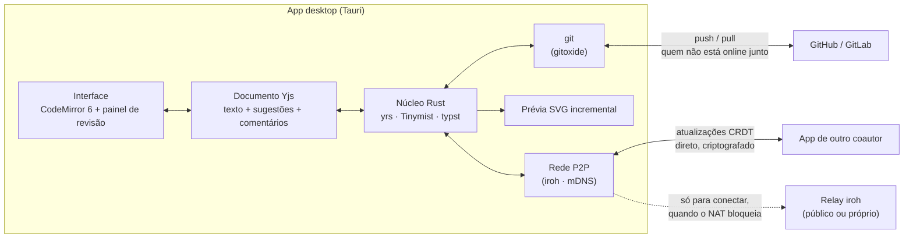
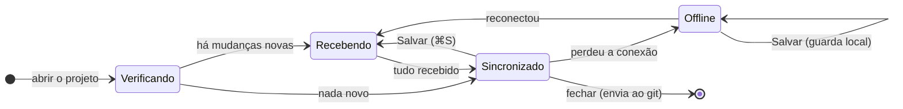
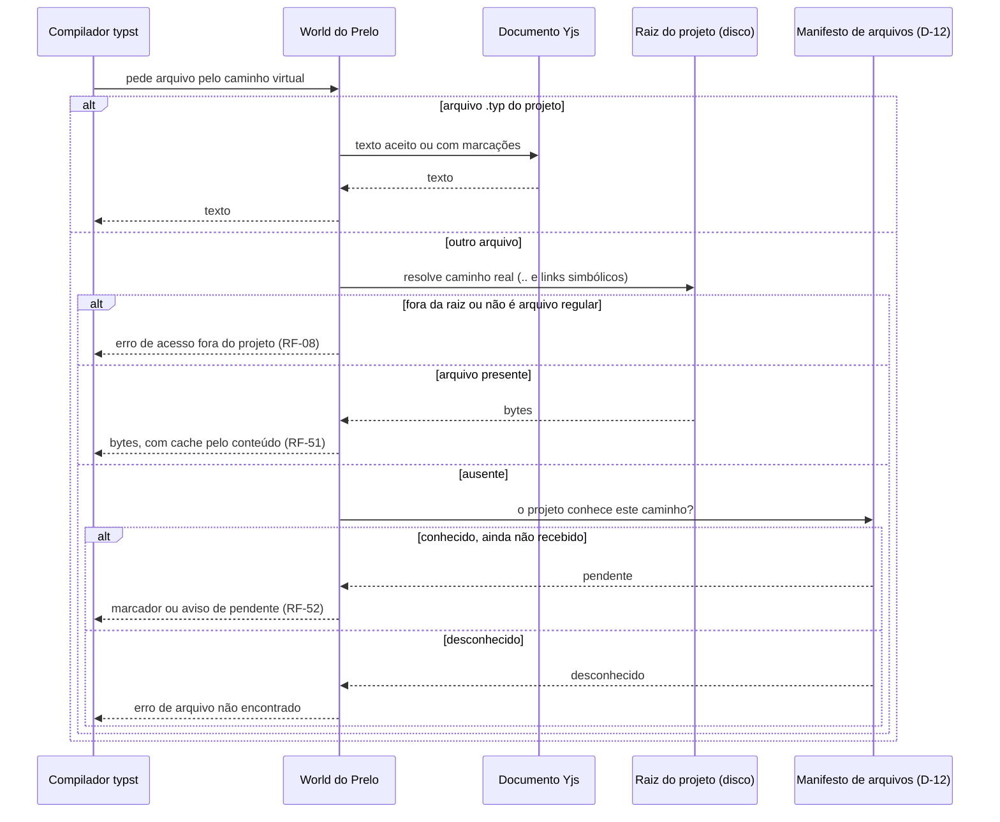

# Prelo · Arquitetura

Versão 0.1 · novembro de 2026 · rascunho para discussão

Como o Prelo atende aos requisitos de [requisitos.md](requisitos.md). Cada escolha estrutural
tem um registro de decisão em [adrs.md](adrs.md).

---

## Sumário

1. [Visão geral](#1-visão-geral)
2. [Arquivos no repositório do artigo](#2-arquivos-no-repositório-do-artigo)
3. [Conexão sem servidor](#3-conexão-sem-servidor)
4. [Modelo de revisão](#4-modelo-de-revisão)
5. [Sincronização](#5-sincronização)
6. [Acesso a arquivos pelo compilador](#6-acesso-a-arquivos-pelo-compilador)
7. [Riscos técnicos e questões em aberto](#7-riscos-técnicos-e-questões-em-aberto)

---

## 1. Visão geral

O app é um shell **Tauri** (D-01): interface em HTML/TypeScript e núcleo em Rust, com instaladores leves para os três sistemas. O compilador Typst e o Tinymist já são escritos em Rust e rodam no mesmo processo: o Prelo compila o artigo sozinho, sem `typst` externo (RF-06, D-10).



| Componente | Tecnologia | Papel | Requisitos |
|---|---|---|---|
| Shell | Tauri | Janela, menus, instaladores, ponte entre interface e núcleo | RNF-01 |
| Editor | CodeMirror 6 + y-codemirror.next | Edição, cursores de outras pessoas, desfazer por usuário | RF-01, RF-14, RF-20 |
| Documento compartilhado | Yjs (interface) e yrs (núcleo) | CRDT: edições simultâneas se fundem sem conflito, também depois de períodos offline | RF-20, RF-30 |
| Compilação e prévia | typst + Tinymist, embutidos | Diagnósticos, autocompletar, prévia SVG incremental, PDFs; leitura de arquivos restrita ao projeto ([seção 6](#6-acesso-a-arquivos-pelo-compilador)) | RF-01, RF-02, RF-06, RF-08, RF-09, RF-42–44, RF-50–54 |
| Rede | iroh + mDNS | Conexão direta entre computadores ([seção 3](#3-conexão-sem-servidor)) | RF-23, RNF-02 |
| Histórico | gitoxide | Commit, push, pull, versões nomeadas | RF-33, RF-40, RF-41 |

## 2. Arquivos no repositório do artigo

```
meu-artigo/
├── main.typ                # texto aceito, Typst puro
├── refs.bib
├── figures/
└── .prelo/
    ├── review.json         # sugestões e comentários abertos e resolvidos
    ├── project.json        # participantes (chaves públicas), papéis e versão do compilador
    └── versions.json       # versões nomeadas
```

O `.typ` é a fonte de verdade no git (D-02, RNF-05). Sugestões e comentários ficam em `.prelo/`, então quem não usa o Prelo continua vendo um repositório Typst normal.

## 3. Conexão sem servidor

O Yjs junta as edições dentro de cada computador, então não é preciso um servidor central para resolver conflitos. O que falta é os computadores se encontrarem (D-04).

| Situação | Como conecta | Precisa de servidor? |
|---|---|---|
| Mesma rede (laboratório, Wi-Fi da universidade) | Descoberta por mDNS e conexão direta. Se a rede bloquear a descoberta, digita-se o endereço do colega. | Nenhum |
| Internet, conexão direta possível | iroh abre conexão QUIC e atravessa o NAT (hole punching) | Só um relay para o primeiro contato |
| Internet, rede muito fechada | Tráfego passa pelo relay do iroh, criptografado de ponta a ponta | Um relay, público ou do grupo |
| Rede privada existente (Tailscale, ZeroTier, VPN) | Os computadores já se enxergam | Nenhum além da VPN |
| Ninguém online ao mesmo tempo | Salvar e fechar gravam no git; quem abre depois faz pull (D-05) | O GitHub ou GitLab do grupo |

**Par sempre ligado (opcional)**: um grupo que queira entrega mesmo sem ninguém online pode deixar um computador do laboratório rodando o Prelo. Ele é só mais um participante, com o mesmo código.

## 4. Modelo de revisão

### Sugestões

Uma sugestão é um **atributo sobre um trecho do texto CRDT**, nunca uma marcação dentro do `.typ` (D-02). Uma exclusão sugerida mantém o texto, marcado como excluído, até alguém decidir.

```ts
// Y.Text com atributos de formatação
text.format(start, length, {
  suggestion: { id: "s1", kind: "delete", author: "ana", at: "2026-11-18T14:02" }
})
text.insert(pos, "is grounded in", {
  suggestion: { id: "s1", kind: "insert", author: "ana", at: "2026-11-18T14:02" }
})
```

| Ação | Inserção sugerida | Exclusão sugerida |
|---|---|---|
| Aceitar | Remove o atributo; o texto fica | Apaga o texto |
| Rejeitar | Apaga o texto | Remove o atributo; o texto fica |

Uma substituição é uma exclusão e uma inserção com o mesmo `id`.

### Comentários

Comentários ficam ancorados por **posições relativas** do Yjs, que continuam no lugar certo mesmo quando o texto antes deles é editado.

```ts
comments.set("c1", {
  start: Y.createRelativePositionFromTypeIndex(text, 212),
  end:   Y.createRelativePositionFromTypeIndex(text, 275),
  status: "open",                       // open | resolved
  thread: [{ author: "bruno", body: "Qual organização?", at: "…" }]
})
```

### Compilação

O núcleo gera duas versões do texto para o compilador embutido:

- **Texto aceito**: ignora inserções pendentes e mantém o texto das exclusões pendentes. Vai para o git e para o PDF final.
- **Texto com marcações**: envolve cada sugestão em `#highlight` e `#strike`. Serve só para a prévia e para o PDF de revisão.

Para cada sugestão pendente, o núcleo compila em segundo plano a versão "aceito + esta sugestão". Se não compilar (ex.: apagar um `]`), o cartão recebe um aviso e o Aceitar fica desativado (RF-15).

O PDF de diferenças (RF-44) reaproveita esse caminho: a diferença entre duas versões nomeadas vira sugestões temporárias, compiladas como texto com marcações.

## 5. Sincronização

As regras e o que cada estado permite estão em [requisitos.md §5](requisitos.md#5-regras-de-offline-e-sincronização).



### Sequência de um Salvar

1. Bloqueia a edição (o editor continua legível).
2. Recebe atualizações dos pares online e faz pull do git.
3. Envia a fila local e as edições aos pares online.
4. Grava commit `Prelo sync · <autor> · <resumo>` e faz push.
5. Libera a edição e mostra o resumo do que mudou.

## 6. Acesso a arquivos pelo compilador

O compilador typst não lê o disco sozinho. Ele pede cada arquivo a um **World**, a interface que o núcleo implementa. É nesse ponto que o Prelo restringe o que pode ser lido, reaproveita arquivos já carregados e trata arquivos que ainda não chegaram. Prévia, diagnósticos, autocompletar do Tinymist, teste de sugestões (RF-15) e todos os PDFs usam o mesmo World, na versão registrada em `.prelo/project.json` (RF-06, RF-07, D-10).

O `.typ` e os demais arquivos do projeto chegam de outros coautores. Para o núcleo, eles são **entrada não confiável** (Princípio VI): um `.typ` não pode ser capaz de ler arquivos do computador de quem compila.

### 6.1 O que o compilador lê

| Tipo | Exemplos no `.typ` | De onde vêm os bytes | Requisitos e decisões |
|---|---|---|---|
| Texto Typst | `#include "cap1.typ"`, `#import "utils.typ"` | Documento Yjs: texto aceito ou texto com marcações ([seção 4](#compilação)) | RF-06, D-02 |
| Bibliografia | `#bibliography("refs.bib", style: "abnt.csl")` | Raiz do projeto: `.bib`, `.yml`/`.yaml`, `.csl` | RF-09; edição concorrente em D-14 |
| Imagens | `#image("figures/fig1.png")` | Raiz do projeto: PNG, JPEG, GIF, SVG; PDF e WebP a partir do Typst 0.14.0 | RF-50, RF-51 |
| Dados | `read`, `json`, `yaml`, `toml`, `csv`, `xml`, `cbor` | Raiz do projeto | RF-08 |
| Plugins | `plugin("calc.wasm")` | Raiz do projeto ou pasta do pacote | RF-08; risco na [seção 7](#7-riscos-técnicos-e-questões-em-aberto) |
| Pacotes | `#import "@preview/nome:1.0.0"` | Cache local de pacotes, baixado do registro do Typst | RF-08; risco na [seção 7](#7-riscos-técnicos-e-questões-em-aberto) |
| Fontes | `#set text(font: "…")` | Não vêm por caminho do `.typ`: o World entrega a lista de fontes | TODO(fontes), [seção 6.5](#65-fontes-e-pacotes) |

TODO(multi-arquivo): confirmar que cada `.typ` do projeto, e não só o principal, é um `Y.Text` no documento Yjs. Se algum `.typ` for lido do disco, ele passa pelas mesmas regras da seção 6.2.

### 6.2 Regras de escopo (RF-08)

Para cada pedido de arquivo, o World segue esta ordem:

1. Recebe do typst o caminho virtual do arquivo e, se for o caso, o pacote a que ele pertence. Caminho começando com `/` é relativo à raiz, como no Typst.
2. Escolhe a raiz: a pasta do projeto ou, para pacote, a pasta `nome@versão` no cache de pacotes. A raiz é resolvida para caminho real uma vez, ao abrir o projeto.
3. Junta raiz e caminho e resolve `..` e links simbólicos até o caminho real. O Prelo não depende da normalização feita pelo próprio typst.
4. Recusa se o caminho real não estiver dentro da raiz real.
5. Recusa se o alvo não for arquivo regular (dispositivo, FIFO, socket).
6. Lê o arquivo. A conferência dos passos 4 e 5 **deveria** ser feita sobre o arquivo já aberto, para que um link trocado entre a conferência e a leitura não escape da raiz.
7. Guarda os bytes em cache pelo conteúdo. Enquanto o conteúdo não muda, a imagem decodificada e a bibliografia processada são reaproveitadas (RF-51).

Uma recusa vira diagnóstico no editor, com o caminho pedido e o motivo, e nunca expõe o conteúdo. Um `..` que continua dentro da raiz, como `../utils.typ` a partir de `capitulos/`, é aceito.

Testes de segurança exigidos (Princípio VI): `..` além da raiz, `/` seguido de `..`, link simbólico versionado para fora, link simbólico interno (aceito), FIFO, caminho de pacote saindo da pasta do pacote e autocompletar de caminhos.

**Trade-off.** O projeto fica autocontido, e o `.typ` continua compilando fora do Prelo com o projeto como raiz (Princípio I). O custo: um `.bib` compartilhado entre artigos precisa entrar no projeto (D-13, proposta), e links simbólicos para pastas pessoais, comuns em instalações de LaTeX, deixam de funcionar.

### 6.3 Como um arquivo é resolvido

Pergunta: o que o núcleo responde quando o compilador pede um arquivo do projeto?



O diagrama não mostra arquivos de pacote, que seguem os mesmos passos com a pasta do pacote como raiz e não consultam o manifesto. Também não mostra fontes, invalidação do cache quando um arquivo muda nem o autocompletar do Tinymist, que usa o mesmo World. O manifesto ainda não existe: ele depende de D-12, que está proposta. Hoje o protótipo já mostra "Figuras · 118 de 131 arquivos" durante a entrada, o que pressupõe uma lista de arquivos conhecida antes dos bytes.

### 6.4 Arquivos pendentes (RF-52 a RF-54)

Um arquivo é **pendente** quando o projeto sabe que ele existe, mas os bytes ainda não chegaram a este computador. Isso acontece porque o texto chega antes das figuras (fluxo 6.1, passo 7 de [requisitos.md](requisitos.md#61-entrada-no-projeto)).

| Situação do arquivo referenciado | Prévia | Exportar PDF final | Aceitar sugestão |
|---|---|---|---|
| Presente | Normal | Permitido | Conforme RF-15 |
| Imagem pendente | Marcador com o nome do arquivo | Bloqueado, com a lista do que falta (RF-53) | Não é afetado (RF-54) |
| Bibliografia, `.typ` ou dado pendente | Última compilação bem-sucedida, com aviso "Aguardando <arquivo>" | Bloqueado (RF-53) | Não é afetado (RF-54) |
| Desconhecido pelo projeto | Diagnóstico de arquivo não encontrado | Bloqueado: o artigo não compila | Conforme RF-15 |

O marcador existe só dentro do Prelo. Ele nunca vai para o git nem para o PDF final, porque fora do Prelo não haveria marcador e o `.typ` precisa compilar igual (Princípio I).

No teste de sugestões em segundo plano (RF-15), erros cujo único motivo é arquivo pendente são descontados. Os demais erros continuam desativando o Aceitar.

Os estados de sincronização continuam os quatro de [requisitos.md §5](requisitos.md#5-regras-de-offline-e-sincronização). O estado Sincronizado se refere ao texto; figuras podem terminar depois (D-07). TODO(estado-arquivos): como o indicador mostra arquivos pendentes no estado Sincronizado sem criar um quinto estado.

### 6.5 Fontes e pacotes

**Fontes.** O `.typ` pede fontes pelo nome; quem decide quais existem é o World. Falta decidir a origem:

| Opção | Ganho | Custo |
|---|---|---|
| Só fontes embutidas no app | Todos os coautores compilam igual (objetivo de D-10) | App maior; artigo limitado às fontes embutidas |
| Embutidas + fontes do sistema | Usa o que já está instalado | Prévia e PDF podem mudar de um computador para outro |
| Embutidas + pasta de fontes no projeto | Reprodutível e flexível | Arquivos de fonte vão para o git; a licença de cada fonte precisa permitir redistribuição |

TODO(fontes): quais fontes vêm embutidas, se fontes do sistema são lidas e se uma pasta de fontes no projeto é aceita (ela seguiria RF-08). TODO(licença-fontes): fontes costumam ter licença própria (ex.: OFL), e RNF-06 só cita Apache-2.0 e MIT; confirmar se fontes embutidas entram na mesma regra.

**Pacotes.** Pacotes `@preview` são baixados do registro do Typst para um cache local e lidos com a pasta do pacote como raiz (RF-08). Eles são entrada não confiável: trazem código Typst e podem trazer plugins WASM. O download revela ao registro o nome e a versão dos pacotes e o endereço IP de quem baixa, mas não o conteúdo do artigo (Princípio II). Pacotes `@local` ficam na máquina de quem os criou e não existem nos outros computadores, como um arquivo fora do projeto (D-13). Cache para compilar offline e cache no git continuam em aberto ([seção 7](#7-riscos-técnicos-e-questões-em-aberto)).

### 6.6 Decisões

Decididas pelo dono em 2026-11-18:

| ID | Pergunta | Decisão |
|---|---|---|
| [D-12](adrs.md#d-12-transporte-de-arquivos-binários-entre-coautores) | Como imagens e outros binários chegam aos coautores? | Blobs por iroh com manifesto no documento Yjs, git como canal assíncrono |
| [D-13](adrs.md#d-13-arquivos-fora-do-projeto) | Como usar um arquivo fora do projeto, como um `.bib` compartilhado? | Não permitir; copiar para dentro do projeto |
| [D-14](adrs.md#d-14-edição-concorrente-de-bibliografia) | `.bib` e `.yml` se fundem pelo CRDT ou como arquivo inteiro? | CRDT de texto, como o `.typ`; `.csl` como arquivo inteiro |

## 7. Riscos técnicos e questões em aberto

- **Edição fora do app.** Se alguém editar o `.typ` no VS Code e fizer push, o Prelo precisa transformar o diff em sugestões de um autor "externo". Falta definir como tratar trechos que mudaram nos dois lados.
- **Redes que bloqueiam P2P.** Algumas redes bloqueiam UDP; o tráfego passa sempre pelo relay. Decidir entre relays públicos do iroh ou relay próprio do grupo.
- **Bloqueio enquanto sincroniza.** O app só sabe o que recebeu de quem está online e do git. Mudanças de quem ainda não reconectou chegam depois; itens sobre trechos alterados são realocados com ajuda do usuário (RF-37).
- **Sincronização lenta.** Muitas figuras podem demorar. O bloqueio vale só para o texto: o documento chega primeiro e as figuras terminam sem travar a edição. Enquanto isso, a prévia mostra marcadores e o PDF final fica bloqueado (RF-52, RF-53). O transporte das figuras depende de D-12 (proposta).
- **Conteúdo gerado.** Texto vindo de funções ou `#include` aparece na prévia mas não no arquivo aberto. Comentar na prévia precisa levar ao arquivo de origem.
- **Pacotes e fontes na compilação embutida.** Pacotes `@preview` do Typst Universe são baixados da internet. Falta definir cache local para compilar offline, se o cache vai para o git e quais fontes vêm embutidas no app ([seção 6.5](#65-fontes-e-pacotes)).
- **Fontes diferentes entre coautores.** Se o World ler fontes do sistema, dois coautores na mesma versão do compilador podem ver prévia e PDF diferentes, o que anula parte do objetivo de D-10. TODO(fontes).
- **Plugins WASM de coautores.** `plugin()` executa código WASM vindo do projeto ou de um pacote. O typst o roda em sandbox, mas é código de terceiros executado no computador de quem compila. TODO(plugins): permitir sempre, pedir confirmação na primeira vez ou recusar.
- **Imagens grandes na prévia.** RF-51 cobre edições que não tocam a imagem. A primeira compilação depois que uma imagem grande chega ou muda, e o envio dela para a prévia na interface, podem passar da meta de RF-02. TODO(imagem-grande).
- **Escape da raiz do projeto.** Um link simbólico versionado ou trocado durante a leitura pode tentar levar o compilador para fora do projeto. Mitigação: RF-08, conferência sobre o arquivo aberto ([seção 6.2](#62-regras-de-escopo-rf-08)) e testes de segurança.
- **Atualizar o compilador.** Uma versão nova do Typst pode mudar o layout. Falta definir quando o app atualiza a versão registrada no projeto e quem decide.
- **Compatibilidade com o Typst web app.** Não há API pública documentada para sincronizar com projetos do typst.app; a interoperação seria pelo git.
