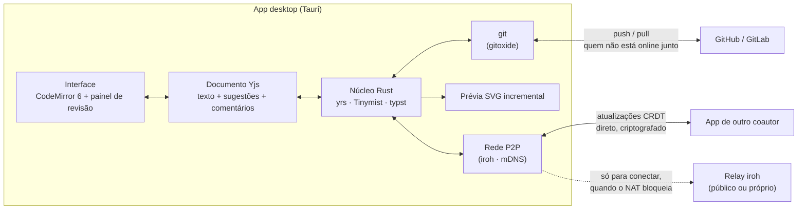
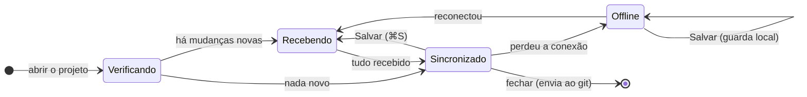

# Prelo · Arquitetura

Versão 0.1 · novembro de 2026 · rascunho para discussão

Como o Prelo atende aos requisitos de [requisitos.md](requisitos.md). Cada escolha estrutural
tem um registro de decisão em [adrs.md](adrs.md).

---

## Sumário

1. [Visão geral](#1-visão-geral)
2. [Arquivos no repositório do artigo](#2-arquivos-no-repositório-do-artigo)
3. [Conexão sem servidor](#3-conexão-sem-servidor)
4. [Modelo de revisão](#4-modelo-de-revisão)
5. [Sincronização](#5-sincronização)
6. [Riscos técnicos e questões em aberto](#6-riscos-técnicos-e-questões-em-aberto)

---

## 1. Visão geral

O app é um shell **Tauri** (D-01): interface em HTML/TypeScript e núcleo em Rust, com instaladores leves para os três sistemas. O compilador Typst e o Tinymist já são escritos em Rust e rodam no mesmo processo: o Prelo compila o artigo sozinho, sem `typst` externo (RF-06, D-10).



| Componente | Tecnologia | Papel | Requisitos |
|---|---|---|---|
| Shell | Tauri | Janela, menus, instaladores, ponte entre interface e núcleo | RNF-01 |
| Editor | CodeMirror 6 + y-codemirror.next | Edição, cursores de outras pessoas, desfazer por usuário | RF-01, RF-14, RF-20 |
| Documento compartilhado | Yjs (interface) e yrs (núcleo) | CRDT: edições simultâneas se fundem sem conflito, também depois de períodos offline | RF-20, RF-30 |
| Compilação e prévia | typst + Tinymist, embutidos | Diagnósticos, autocompletar, prévia SVG incremental, PDFs | RF-01, RF-02, RF-06, RF-42–44 |
| Rede | iroh + mDNS | Conexão direta entre computadores ([seção 3](#3-conexão-sem-servidor)) | RF-23, RNF-02 |
| Histórico | gitoxide | Commit, push, pull, versões nomeadas | RF-33, RF-40, RF-41 |

## 2. Arquivos no repositório do artigo

```
meu-artigo/
├── main.typ                # texto aceito, Typst puro
├── refs.bib
├── figures/
└── .prelo/
    ├── review.json         # sugestões e comentários abertos e resolvidos
    ├── project.json        # participantes (chaves públicas), papéis e versão do compilador
    └── versions.json       # versões nomeadas
```

O `.typ` é a fonte de verdade no git (D-02, RNF-05). Sugestões e comentários ficam em `.prelo/`, então quem não usa o Prelo continua vendo um repositório Typst normal.

## 3. Conexão sem servidor

O Yjs junta as edições dentro de cada computador, então não é preciso um servidor central para resolver conflitos. O que falta é os computadores se encontrarem (D-04).

| Situação | Como conecta | Precisa de servidor? |
|---|---|---|
| Mesma rede (laboratório, Wi-Fi da universidade) | Descoberta por mDNS e conexão direta. Se a rede bloquear a descoberta, digita-se o endereço do colega. | Nenhum |
| Internet, conexão direta possível | iroh abre conexão QUIC e atravessa o NAT (hole punching) | Só um relay para o primeiro contato |
| Internet, rede muito fechada | Tráfego passa pelo relay do iroh, criptografado de ponta a ponta | Um relay, público ou do grupo |
| Rede privada existente (Tailscale, ZeroTier, VPN) | Os computadores já se enxergam | Nenhum além da VPN |
| Ninguém online ao mesmo tempo | Salvar e fechar gravam no git; quem abre depois faz pull (D-05) | O GitHub ou GitLab do grupo |

**Par sempre ligado (opcional)**: um grupo que queira entrega mesmo sem ninguém online pode deixar um computador do laboratório rodando o Prelo. Ele é só mais um participante, com o mesmo código.

## 4. Modelo de revisão

### Sugestões

Uma sugestão é um **atributo sobre um trecho do texto CRDT**, nunca uma marcação dentro do `.typ` (D-02). Uma exclusão sugerida mantém o texto, marcado como excluído, até alguém decidir.

```ts
// Y.Text com atributos de formatação
text.format(start, length, {
  suggestion: { id: "s1", kind: "delete", author: "ana", at: "2026-11-18T14:02" }
})
text.insert(pos, "is grounded in", {
  suggestion: { id: "s1", kind: "insert", author: "ana", at: "2026-11-18T14:02" }
})
```

| Ação | Inserção sugerida | Exclusão sugerida |
|---|---|---|
| Aceitar | Remove o atributo; o texto fica | Apaga o texto |
| Rejeitar | Apaga o texto | Remove o atributo; o texto fica |

Uma substituição é uma exclusão e uma inserção com o mesmo `id`.

### Comentários

Comentários ficam ancorados por **posições relativas** do Yjs, que continuam no lugar certo mesmo quando o texto antes deles é editado.

```ts
comments.set("c1", {
  start: Y.createRelativePositionFromTypeIndex(text, 212),
  end:   Y.createRelativePositionFromTypeIndex(text, 275),
  status: "open",                       // open | resolved
  thread: [{ author: "bruno", body: "Qual organização?", at: "…" }]
})
```

### Compilação

O núcleo gera duas versões do texto para o compilador embutido:

- **Texto aceito**: ignora inserções pendentes e mantém o texto das exclusões pendentes. Vai para o git e para o PDF final.
- **Texto com marcações**: envolve cada sugestão em `#highlight` e `#strike`. Serve só para a prévia e para o PDF de revisão.

Para cada sugestão pendente, o núcleo compila em segundo plano a versão "aceito + esta sugestão". Se não compilar (ex.: apagar um `]`), o cartão recebe um aviso e o Aceitar fica desativado (RF-15).

O PDF de diferenças (RF-44) reaproveita esse caminho: a diferença entre duas versões nomeadas vira sugestões temporárias, compiladas como texto com marcações.

## 5. Sincronização

As regras e o que cada estado permite estão em [requisitos.md §5](requisitos.md#5-regras-de-offline-e-sincronização).



### Sequência de um Salvar

1. Bloqueia a edição (o editor continua legível).
2. Recebe atualizações dos pares online e faz pull do git.
3. Envia a fila local e as edições aos pares online.
4. Grava commit `Prelo sync · <autor> · <resumo>` e faz push.
5. Libera a edição e mostra o resumo do que mudou.

## 6. Riscos técnicos e questões em aberto

- **Edição fora do app.** Se alguém editar o `.typ` no VS Code e fizer push, o Prelo precisa transformar o diff em sugestões de um autor "externo". Falta definir como tratar trechos que mudaram nos dois lados.
- **Redes que bloqueiam P2P.** Algumas redes bloqueiam UDP; o tráfego passa sempre pelo relay. Decidir entre relays públicos do iroh ou relay próprio do grupo.
- **Bloqueio enquanto sincroniza.** O app só sabe o que recebeu de quem está online e do git. Mudanças de quem ainda não reconectou chegam depois; itens sobre trechos alterados são realocados com ajuda do usuário (RF-37).
- **Sincronização lenta.** Muitas figuras podem demorar. O bloqueio vale só para o texto: o documento chega primeiro e as figuras terminam sem travar a edição.
- **Conteúdo gerado.** Texto vindo de funções ou `#include` aparece na prévia mas não no arquivo aberto. Comentar na prévia precisa levar ao arquivo de origem.
- **Pacotes e fontes na compilação embutida.** Pacotes `@preview` do Typst Universe são baixados da internet. Falta definir cache local para compilar offline, se o cache vai para o git e quais fontes vêm embutidas no app.
- **Atualizar o compilador.** Uma versão nova do Typst pode mudar o layout. Falta definir quando o app atualiza a versão registrada no projeto e quem decide.
- **Compatibilidade com o Typst web app.** Não há API pública documentada para sincronizar com projetos do typst.app; a interoperação seria pelo git.
