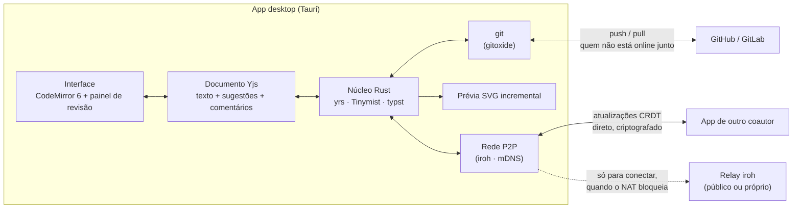
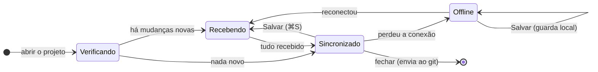

# Prelo · Especificação

Versão 0.1 · novembro de 2026 · rascunho para discussão

Prelo é um editor desktop para escrever artigos científicos em [Typst](https://typst.app) a várias mãos. Ele junta, numa só ferramenta, o que hoje está espalhado: edição com prévia instantânea, sugestões que se aceitam ou rejeitam, comentários em conversa, trabalho offline e histórico no git.

O nome vem da prensa tipográfica. Um texto "no prelo" é um texto prestes a ser publicado, que é a fase que a ferramenta atende.

---

## Sumário

1. [Problema](#1-problema)
2. [Alternativas existentes](#2-alternativas-existentes)
3. [Escopo](#3-escopo)
4. [Papéis e permissões](#4-papéis-e-permissões)
5. [Requisitos funcionais](#5-requisitos-funcionais)
6. [Requisitos não funcionais](#6-requisitos-não-funcionais)
7. [Arquitetura](#7-arquitetura)
8. [Conexão sem servidor](#8-conexão-sem-servidor)
9. [Modelo de revisão](#9-modelo-de-revisão)
10. [Offline e sincronização](#10-offline-e-sincronização)
11. [Fluxos](#11-fluxos)
12. [PDF de diferenças](#12-pdf-de-diferenças)
13. [Decisões tomadas](#13-decisões-tomadas)
14. [Riscos e decisões em aberto](#14-riscos-e-decisões-em-aberto)
15. [Plano de construção](#15-plano-de-construção)
16. [Fontes](#16-fontes)

---

## 1. Problema

O Typst compila em milissegundos e tem uma sintaxe mais limpa que a do LaTeX. Para um artigo com coautores, orientadores e revisores, porém, o trabalho que mais consome tempo é a revisão: alguém sugere uma frase, outro comenta uma figura, o autor principal aceita parte e rejeita o resto. Hoje esse ciclo acontece em ferramentas que não juntam tudo isso para Typst:

- O **Overleaf** tem controle de alterações e papel de revisor, mas só funciona com LaTeX.
- O **Typst web app** tem edição em tempo real e comentários (no plano Pro), sem controle de alterações documentado, e funciona só online.
- **VS Code + Tinymist + git** funciona offline e tem ótima prévia, mas a revisão vira diff do git e comentário no código-fonte.

## 2. Alternativas existentes

Levantamento feito em novembro de 2026 a partir da documentação de cada ferramenta. "Não verificado" indica que a documentação não confirma o recurso.

| Ferramenta | Typst | Tempo real | Comentários | Controle de alterações | Offline / desktop | Git | Auto-hospedagem |
|---|---|---|---|---|---|---|---|
| Overleaf | Não | Sim | Sim, em todos os planos | Sim, premium; papel "pode revisar" | Não | Sim, planos pagos | Community Edition, sem controle de alterações |
| Typst web app | Sim | Sim | Sim, se o dono for Pro; sem menções | Não documentado | Não | Não verificado | Não |
| VS Code + Tinymist + git | Sim | Via Live Share | Só no código | Só diff do git | Sim | Sim | Não se aplica |
| TeXlyre | Sim, e LaTeX | Sim | Não verificado | Não verificado | Local-first, no navegador | Não verificado | Sim |
| Collabst · TINO | Sim | Sim | Collabst: sim | Não verificado | Web | Não verificado | Sim |
| **Prelo** | Sim | Sim | Sim, com menções e conversa | Sim, aceitar e rejeitar | Sim, app desktop | Sim, nativo | Não precisa de servidor |

Nenhuma opção documentada junta Typst, controle de alterações no estilo do Overleaf, trabalho offline e git. Esse é o espaço do Prelo.

## 3. Escopo

**Dentro do escopo**

- Projetos Typst com vários arquivos (`.typ`, `.bib`, figuras).
- Edição por várias pessoas, ao mesmo tempo ou em horários diferentes.
- Sugestões, comentários, histórico e versões nomeadas.
- Integração com repositórios git (GitHub, GitLab ou qualquer remoto).
- Exportação de PDF final, PDF com marcações e PDF de diferenças.

**Fora do escopo na primeira versão**

- Edição de LaTeX.
- Versão web ou mobile.
- Gerenciamento de referências além do `.bib` (Zotero etc. ficam por arquivo).
- Submissão direta a revistas.

## 4. Papéis e permissões

| Papel | Ler | Comentar | Sugerir | Editar direto | Aceitar / rejeitar sugestões | Convidar e mudar papéis |
|---|---|---|---|---|---|---|
| Dono | Sim | Sim | Sim | Sim | Sim | Sim |
| Coautor | Sim | Sim | Sim | Sim | Sim | Não |
| Revisor | Sim | Sim | Sim (todas as edições viram sugestões) | Não | Não | Não |
| Leitor | Sim | Não | Não | Não | Não | Não |

Regras sobre comentários:

| Ação | Quem pode |
|---|---|
| Resolver comentário | Todos, menos leitor |
| Reabrir comentário resolvido | Todos, menos leitor |
| Apagar a própria mensagem | Autor da mensagem |
| Excluir conversa inteira | Quem abriu a conversa e o dono |
| Excluir todos os resolvidos | Dono |

## 5. Requisitos funcionais

### Escrita

- **RF-01** Editor de código Typst com realce de sintaxe, autocompletar e diagnósticos fornecidos pelo Tinymist.
- **RF-02** Prévia ao lado do editor, atualizada enquanto se digita (meta: menos de 100 ms em artigos de até 40 páginas).
- **RF-03** Sincronização entre código e prévia: clicar na prévia leva à linha do código, e vice-versa.
- **RF-04** Árvore de arquivos e estrutura de seções (outline) com contagem de pendências de revisão por seção.
- **RF-05** Suporte a `.bib` e figuras dentro do projeto.

### Revisão

- **RF-10** Três modos de trabalho: **Editando** (alterações entram direto), **Sugerindo** (alterações viram sugestões) e **Lendo** (só leitura e comentários).
- **RF-11** Sugestões de inserção, exclusão e substituição, marcadas no código e na prévia com a cor do autor.
- **RF-12** Aceitar ou rejeitar uma sugestão pelo cartão no painel de revisão ou clicando no trecho marcado. Atalhos: ⌘↵ aceita, ⌘⌫ rejeita, ⌥↓ vai para a próxima.
- **RF-13** Aceitar ou rejeitar em lote, com filtro por pessoa e por seção, e confirmação na própria tela mostrando a contagem.
- **RF-14** Desfazer um aceite ou rejeição (⌘Z ou botão Desfazer no aviso).
- **RF-15** Testar cada sugestão em segundo plano. Uma sugestão que quebra a compilação aparece com aviso e o botão Aceitar desativado.
- **RF-16** Comentários ancorados num trecho, com respostas, menções (@nome), resolver, reabrir e excluir.
- **RF-17** Aba "Resolvidos" com as conversas resolvidas, de onde se pode reabrir ou excluir.
- **RF-18** Prévia em dois modos: com marcações ou só com o texto aceito.
- **RF-19** Ao aceitar sugestões, propor um commit com mensagem pronta (ex.: "Accept 3 suggestions from Ana in Methodological Approach").

### Colaboração

- **RF-20** Edição simultânea com cursores e presença visíveis.
- **RF-21** Convite por código de uso único, com papel, validade e opção de exigir aprovação do dono.
- **RF-22** Identidade local por chave criptográfica, sem conta nem senha. O dono confere o código da chave antes de aprovar uma entrada.
- **RF-23** Conexão direta entre computadores, sem servidor obrigatório (ver seção 8).
- **RF-24** Remover uma pessoa ou mudar seu papel a qualquer momento.

### Offline e sincronização

- **RF-30** Offline, é possível comentar, responder, resolver e sugerir. Essas ações vão para uma fila persistida no disco.
- **RF-31** Editar direto e aceitar ou rejeitar sugestões só são liberados com os arquivos sincronizados.
- **RF-32** Ao abrir o projeto, o app verifica versões com quem está online e com o git remoto. Se houver mudanças, recebe-as antes de liberar a edição, mantendo o editor em modo leitura.
- **RF-33** **Salvar (⌘S) sincroniza automaticamente**: recebe as mudanças dos outros, envia o trabalho local e grava um commit no git.
- **RF-34** Salvar sem conexão guarda no computador e agenda a sincronização para quando a conexão voltar.
- **RF-35** Ao reconectar, a ordem é sempre: receber, enviar a fila, gravar no git, liberar a edição.
- **RF-36** Ao fechar o app, ele faz um último Salvar.
- **RF-37** Comentário ou sugestão feito offline sobre um trecho que mudou nesse meio tempo não é descartado. O app pergunta se deve mantê-lo no trecho novo ou excluí-lo.
- **RF-38** Após sincronizar, mostrar um resumo do que mudou ("Bruno fez 2 commits, Ana deixou 1 comentário").

### Entrega

- **RF-40** Commit e push pelo próprio app.
- **RF-41** Versões nomeadas no histórico ("Submissão 1", "Revisão R1").
- **RF-42** Exportar PDF final e `.typ` limpos, sem marcações nem comentários.
- **RF-43** Exportar PDF com comentários na margem (para orientadores).
- **RF-44** Exportar PDF de diferenças entre duas versões (ver seção 12).
- **RF-45** Tela "Preparar submissão": lista sugestões pendentes e comentários abertos, e permite excluir todos os resolvidos de uma vez.

## 6. Requisitos não funcionais

- **RNF-01 Plataformas**: macOS, Windows e Linux.
- **RNF-02 Privacidade**: nenhum servidor guarda o conteúdo do artigo. Todo tráfego entre computadores é criptografado de ponta a ponta. Isso atende a textos inéditos e à LGPD.
- **RNF-03 Desempenho**: prévia em menos de 100 ms após uma edição; sincronização de um Salvar em cerca de 1 s em rede comum.
- **RNF-04 Robustez**: fechar o app ou perder a conexão nunca perde trabalho. A fila offline fica no disco.
- **RNF-05 Interoperabilidade**: o `.typ` no repositório é sempre Typst puro, compilável fora do Prelo.
- **RNF-06 Licenças**: só dependências com licenças permissivas (Apache-2.0, MIT).

## 7. Arquitetura

O app é um shell **Tauri**: interface em HTML/TypeScript e núcleo em Rust, com instaladores leves para os três sistemas. O compilador Typst e o Tinymist já são escritos em Rust e rodam no mesmo processo.



| Componente | Tecnologia | Papel |
|---|---|---|
| Shell | Tauri | Janela, menus, instaladores, ponte entre interface e núcleo |
| Editor | CodeMirror 6 + y-codemirror.next | Edição, cursores de outras pessoas, desfazer por usuário |
| Documento compartilhado | Yjs (interface) e yrs (núcleo) | CRDT: edições simultâneas se fundem sem conflito, também depois de períodos offline |
| Compilação e prévia | typst + Tinymist | Diagnósticos, autocompletar, prévia SVG incremental |
| Rede | iroh + mDNS | Conexão direta entre computadores (seção 8) |
| Histórico | gitoxide | Commit, push, pull, versões nomeadas |

**Arquivos no repositório do artigo**

```
meu-artigo/
├── main.typ                # texto aceito, Typst puro
├── refs.bib
├── figures/
└── .prelo/
    ├── review.json         # sugestões e comentários abertos e resolvidos
    ├── project.json        # participantes (chaves públicas) e papéis
    └── versions.json       # versões nomeadas
```

O `.typ` é a fonte de verdade no git. Sugestões e comentários ficam em `.prelo/`, então quem não usa o Prelo continua vendo um repositório Typst normal.

## 8. Conexão sem servidor

O Yjs junta as edições dentro de cada computador, então não é preciso um servidor central para resolver conflitos. O que falta é os computadores se encontrarem.

| Situação | Como conecta | Precisa de servidor? |
|---|---|---|
| Mesma rede (laboratório, Wi-Fi da universidade) | Descoberta por mDNS e conexão direta. Se a rede bloquear a descoberta, digita-se o endereço do colega. | Nenhum |
| Internet, conexão direta possível | iroh abre conexão QUIC e atravessa o NAT (hole punching) | Só um relay para o primeiro contato |
| Internet, rede muito fechada | Tráfego passa pelo relay do iroh, criptografado de ponta a ponta | Um relay, público ou do grupo |
| Rede privada existente (Tailscale, ZeroTier, VPN) | Os computadores já se enxergam | Nenhum além da VPN |
| Ninguém online ao mesmo tempo | Salvar e fechar gravam no git; quem abre depois faz pull | O GitHub ou GitLab do grupo |

**Por que iroh**: biblioteca Rust que roda no mesmo núcleo do Tauri, ao lado do yrs, e conecta pela chave pública de cada pessoa, sem depender de endereço IP.

**Alternativas avaliadas**: y-webrtc (pronto para Yjs, mas precisa de servidor de sinalização e TURN em redes fechadas) e libp2p (mesma função do iroh, mais complexo).

**Par sempre ligado (opcional)**: um grupo que queira entrega mesmo sem ninguém online pode deixar um computador do laboratório rodando o Prelo. Ele é só mais um participante, com o mesmo código.

## 9. Modelo de revisão

### Sugestões

Uma sugestão é um **atributo sobre um trecho do texto CRDT**, nunca uma marcação dentro do `.typ`. Uma exclusão sugerida mantém o texto, marcado como excluído, até alguém decidir.

```ts
// Y.Text com atributos de formatação
text.format(start, length, {
  suggestion: { id: "s1", kind: "delete", author: "ana", at: "2026-11-18T14:02" }
})
text.insert(pos, "is grounded in", {
  suggestion: { id: "s1", kind: "insert", author: "ana", at: "2026-11-18T14:02" }
})
```

| Ação | Inserção sugerida | Exclusão sugerida |
|---|---|---|
| Aceitar | Remove o atributo; o texto fica | Apaga o texto |
| Rejeitar | Apaga o texto | Remove o atributo; o texto fica |

Uma substituição é uma exclusão e uma inserção com o mesmo `id`.

### Comentários

Comentários ficam ancorados por **posições relativas** do Yjs, que continuam no lugar certo mesmo quando o texto antes deles é editado.

```ts
comments.set("c1", {
  start: Y.createRelativePositionFromTypeIndex(text, 212),
  end:   Y.createRelativePositionFromTypeIndex(text, 275),
  status: "open",                       // open | resolved
  thread: [{ author: "bruno", body: "Qual organização?", at: "…" }]
})
```

Um comentário não muda o texto, então não é aceito nem rejeitado. Ele é **resolvido** quando o pedido foi atendido.

### Compilação

O núcleo gera duas versões do texto para compilar:

- **Texto aceito**: ignora inserções pendentes e mantém o texto das exclusões pendentes. Vai para o git e para o PDF final.
- **Texto com marcações**: envolve cada sugestão em `#highlight` e `#strike`. Serve só para a prévia e para o PDF de revisão.

Para cada sugestão pendente, o núcleo compila em segundo plano a versão "aceito + esta sugestão". Se não compilar (ex.: apagar um `]`), o cartão recebe um aviso e o Aceitar fica desativado (RF-15).

## 10. Offline e sincronização

### Regras

1. **Comentar e sugerir funcionam offline.** As ações vão para uma fila no disco.
2. **Editar direto só com os arquivos sincronizados.** Ao abrir, reconectar ou salvar, o app recebe primeiro as mudanças dos outros e mantém o editor em leitura até terminar.
3. **Salvar (⌘S) sincroniza automaticamente**: recebe, envia e grava no git. Sem conexão, guarda no computador.
4. **Fechar faz um último Salvar**, para que quem abrir depois receba o trabalho pelo git mesmo com o computador do autor desligado.

### Estados



| Estado | Ler | Comentar | Sugerir | Editar direto | Aceitar sugestões |
|---|---|---|---|---|---|
| Verificando / Recebendo | Sim | Espera | Espera | Bloqueado | Bloqueado |
| Sincronizado | Sim | Sim | Sim | Sim | Sim |
| Offline | Sim | Sim, na fila | Sim, na fila | Bloqueado | Bloqueado |

### O que "sincronizado" significa

O app considera os arquivos sincronizados quando recebeu tudo o que está disponível em **quem está online** e no **git remoto**. Mudanças feitas offline por alguém que ainda não reconectou chegam depois; por isso Salvar e fechar sempre gravam no git.

### Sequência de um Salvar

1. Bloqueia a edição (o editor continua legível).
2. Recebe atualizações dos pares online e faz pull do git.
3. Envia a fila local e as edições aos pares online.
4. Grava commit `Prelo sync · <autor> · <resumo>` e faz push.
5. Libera a edição e mostra o resumo do que mudou.

## 11. Fluxos

Os fluxos abaixo estão desenhados tela a tela no protótipo (`prototype/index.html`).

### 11.1 Entrada no projeto

1. **Dono** clica em Compartilhar e escolhe papel, validade e se exige aprovação.
2. **Dono** recebe um código de uso único (com QR) e o envia por canal privado. O código contém a chave do documento.
3. **Convidado** instala o Prelo, escolhe nome e cor; o app cria a chave dele.
4. **Convidado** cola o código ou clica no link `prelo://join/…`.
5. **Convidado**: o app valida o convite e conecta (rede local → internet direta → relay). Se ninguém estiver online, ele espera um aviso ou baixa pelo GitHub.
6. **Dono** vê o pedido de entrada, confere o código da chave e aprova.
7. **Convidado** recebe o texto primeiro, depois figuras e histórico.
8. **Convidado** está no projeto, com cursores e presença visíveis.

### 11.2 Revisão

1. Aceitar ou rejeitar uma sugestão pelo cartão ou pelo trecho marcado.
2. Aceitar em lote filtrando por pessoa e seção.
3. Sugestão que quebra a compilação: aviso e Aceitar desativado.
4. Depois de aceitar: desfazer disponível, histórico registra, commit proposto.
5. Resolver um comentário: responder e clicar em Resolver.
6. Reabrir ou excluir a partir da aba Resolvidos.
7. Excluir uma conversa aberta pelo menu ⋯, com confirmação no cartão.
8. Preparar submissão: listar pendências e excluir resolvidos.

### 11.3 Offline e sincronização

1. Ao abrir: verificação de versões e recebimento das mudanças.
2. Editor em leitura enquanto recebe.
3. Sincronizado: resumo do que mudou e edição liberada.
4. Offline: comentar e sugerir; modo Editando travado.
5. Fila de envio com hora e linha de cada item.
6. Reconectar: receber, enviar a fila, gravar no git, liberar.
7. Trecho que mudou enquanto offline: o app pergunta onde manter o item.
8. Salvar (⌘S): sincroniza na hora.
9. Fechar: último Salvar.

## 12. PDF de diferenças

Revistas costumam pedir, na resubmissão, uma versão com as mudanças marcadas. No LaTeX isso se faz com `latexdiff`; para Typst não há ferramenta equivalente consolidada.

O Prelo compara duas versões nomeadas ("Submissão 1" e "Revisão R1"), aplica a diferença como sugestões temporárias e compila o resultado com marcações. A resposta aos revisores pode citar as mudanças pelo número de linha desse PDF.

## 13. Decisões tomadas

| # | Decisão | Motivo |
|---|---|---|
| D-01 | App desktop com Tauri | Núcleo em Rust, igual ao Typst e ao Tinymist; instaladores leves |
| D-02 | Sugestões como atributos do CRDT, fora do `.typ` | Código-fonte limpo e compilável fora do Prelo |
| D-03 | Comentários são resolvidos, não aceitos | Comentário não muda o texto; resolver indica que o pedido foi atendido |
| D-04 | Conexão P2P com iroh, sem servidor obrigatório | Privacidade de textos inéditos e nenhum custo de infraestrutura |
| D-05 | Git como canal para quem não está online junto | O grupo já usa; dispensa servidor de armazenamento |
| D-06 | Offline só comenta e sugere | Sugestões passam por revisão e não sobrescrevem o trabalho de ninguém |
| D-07 | Edição liberada só com arquivos sincronizados | Evita editar sobre versão antiga |
| D-08 | Salvar (⌘S) sincroniza automaticamente | Um único gesto conhecido garante receber, enviar e gravar no git |
| D-09 | Aceitar e rejeitar sugestões bloqueados offline | Essas ações mudam o texto, então seguem a regra D-07 |

## 14. Riscos e decisões em aberto

- **Edição fora do app.** Se alguém editar o `.typ` no VS Code e fizer push, o Prelo precisa transformar o diff em sugestões de um autor "externo". Falta definir como tratar trechos que mudaram nos dois lados.
- **Redes que bloqueiam P2P.** Algumas redes bloqueiam UDP; o tráfego passa sempre pelo relay. Decidir entre relays públicos do iroh ou relay próprio do grupo.
- **Bloqueio enquanto sincroniza.** O app só sabe o que recebeu de quem está online e do git. Mudanças de quem ainda não reconectou chegam depois; itens sobre trechos alterados são realocados com ajuda do usuário (RF-37).
- **Sincronização lenta.** Muitas figuras podem demorar. O bloqueio vale só para o texto: o documento chega primeiro e as figuras terminam sem travar a edição.
- **Conteúdo gerado.** Texto vindo de funções ou `#include` aparece na prévia mas não no arquivo aberto. Comentar na prévia precisa levar ao arquivo de origem.
- **Compatibilidade com o Typst web app.** Não há API pública documentada para sincronizar com projetos do typst.app; a interoperação seria pelo git.
- **Nome e marca.** Verificar se "Prelo" já é marca registrada (INPI e buscas gerais) antes de divulgar.
- **Licença do próprio Prelo.** Ainda não escolhida.

## 15. Plano de construção

1. **Editor local**: Tauri, CodeMirror 6, Tinymist, prévia SVG e sincronização código ↔ prévia.
2. **Comentários e histórico**: `.prelo/review.json`, commit e push pelo app, versões nomeadas. Colaboração assíncrona via git, com Salvar sincronizando pelo git.
3. **Tempo real sem servidor**: documento Yjs, mDNS na rede local, iroh pela internet, convite por código, cursores e presença. Fila offline e edição liberada só após sincronizar.
4. **Modo sugestão**: sugestões como atributos, aceitar e rejeitar, prévia com marcações, aviso de sugestão que não compila, PDF de diferenças.
5. **Papéis e convites**: revisor e leitor, aprovação de entrada, remoção de participantes, notificações.

## 16. Fontes

- Overleaf: [Track changes](https://docs.overleaf.com/collaborating/track-changes), [Reviewing and reviewers](https://www.overleaf.com/learn/how-to/Reviewing_and_reviewers_on_Overleaf), [Commenting](https://docs.overleaf.com/collaborating/commenting)
- Typst: [Comentários no web app](https://typst.app/docs/web-app/comments/), [Blog: folders e review-only shares](https://typst.app/blog/2025/folders-reviews), [Fórum: menções](https://forum.typst.app/t/how-can-i-mention-other-users-in-comments/4048)
- Alternativas: [Collabst](https://forum.typst.app/t/introducing-collabst-a-self-hosted-collaborative-workspace-for-typst/8856), [TINO](https://forum.typst.app/t/tino-a-collaborative-self-hosted-editing-platform-around-typst/8914), [TeXlyre](https://texlyre.github.io/texlyre/)
- Tecnologia: [Yjs + CodeMirror](https://docs.yjs.dev/ecosystem/editor-bindings/codemirror), [typst-preview / Tinymist](https://github.com/Enter-tainer/typst-preview), [iroh](https://www.iroh.computer/), [y-webrtc](https://github.com/yjs/y-webrtc), [libp2p](https://libp2p.io/)
