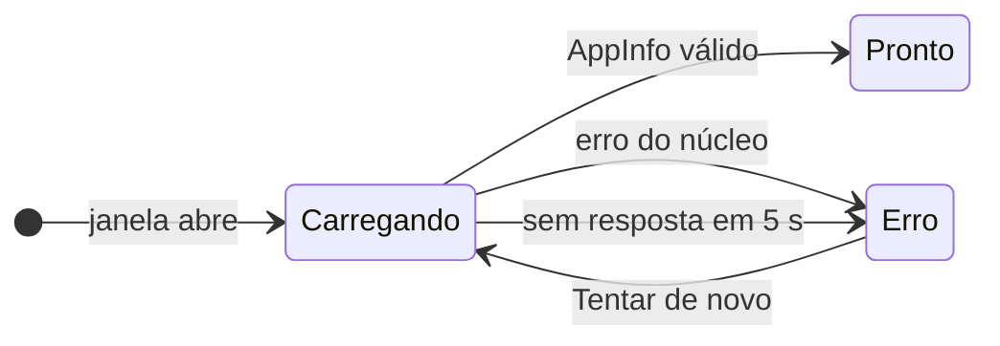

# Data Model: Esqueleto do app desktop Prelo

Sem armazenamento persistente (FR-014). As entidades abaixo existem em memória ou como
arquivos de configuração do repositório.

## AppInfo

Resposta do núcleo à interface (FR-002). Contrato: [contracts/ipc.md](contracts/ipc.md).

| Campo | Tipo | Regra |
|---|---|---|
| `version` | string | SemVer, igual à versão do pacote (`tauri.conf.json` / `Cargo.toml`) |
| `os` | `"macos"` \| `"windows"` \| `"linux"` | Sistema em execução; outro valor é erro |
| `arch` | string | Arquitetura (`x86_64`, `aarch64`) |

## Estado da tela inicial (interface)

| Estado | Exibe |
|---|---|
| Carregando | "Carregando…" |
| Pronto | "Prelo {version} · {os}" |
| Erro | Mensagem compreensível + botão "Tentar de novo"; nunca janela em branco |

## Lista de licenças permitidas

Arquivo `security/licenses-allow.txt`: um identificador SPDX por linha, `#` para comentário.
Fonte única (FR-008). Licença ausente ou fora da lista = falha.

## Exceção de licença por dependência

Em `src-tauri/deny.toml` (`[[licenses.exceptions]]`): `name` (crate), `allow` (SPDX), comentário
com motivo. Só para licenças fora da lista geral aprovadas pelo dono (ver research R4.1).

## Exceção de vulnerabilidade

Arquivo `security/vuln-exceptions.toml`:

| Campo | Tipo | Regra |
|---|---|---|
| `id` | string | ID do aviso (RUSTSEC-…, GHSA-…) |
| `ecosystem` | `"cargo"` \| `"npm"` | |
| `reason` | string | Obrigatório, não vazio |
| `review_by` | data ISO | Passada a data, a auditoria falha |

Exceção sem `reason` ou com `review_by` vencido invalida a auditoria (FR-009).
